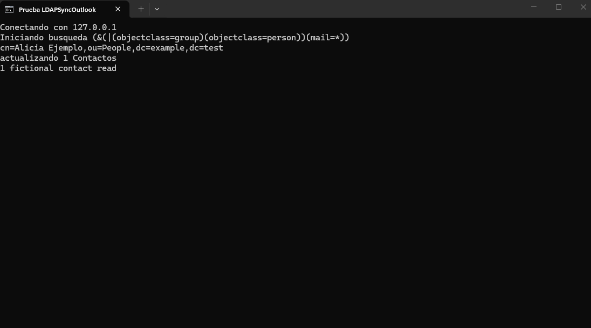

# LDAPSyncOutlook
[English](#english) · [Español](#español)

## English

Archived Windows utility and Outlook add-in to copy contacts from an LDAP directory

> [!WARNING]
> **Status:** Archived application. Check the requirements before opening Outlook.

### Overview

LDAP is a protocol for looking up entries in a shared directory. This project copies a directory’s contacts into Outlook so an operator can look them up from the address book.

### Features

- Choose an LDAP host, search base and time between synchronizations.
- Read contact names and email addresses and keep a mapping to the Outlook destination.
- Configure synchronization from the desktop window or the original Outlook add-in.
- Include groups and people in the LDAP search. Entries with email follow the same contact workflow.

### History

The initial January 1, 2015 revision contains documentation. The source arrives on January 5. The revisions retain the dates recorded in the original archive. The 2026 reconstruction adds the v145 projects and the local trial.

- **2026-11-18** Add a screenshot from the isolated fictional LDAP lookup recorded on November 20, 2026.

### Requirements

The archived Office imports use the registered type libraries. The local Windows installation cannot resolve all of the older registrations. The standalone probe builds the shared directory reader and can be used without Outlook.


Use a Developer PowerShell with the Desktop development with C++ workload, the x86/x64 C++ MFC and ATL components, MSVC v145 14.51.36231 and Windows SDK 10.0.26100.0. Provide the Windows Address Book (WAB) inputs of Windows SDK 7.1 and the type libraries `MSOUTL.OLB` 16.0.19929.20032, `MSO.DLL` from Office 16.0.20527.20196 and `MSADDNDR.DLL` 6.00.8100. The Outlook add-in must match the bitness of the installed Outlook. This solution builds Win32. Use the Office installation paths for your test machine. The build leaves COM registration to the operator. Obtain the WAB headers and x86 library from Microsoft’s Windows SDK 7.1. Use MSOUTL.OLB and MSO.DLL from a licensed installation of 32-bit desktop Outlook and Office. The exact Microsoft package that supplied the tested copy of MSADDNDR.DLL 6.00.8100 could not be identified. If the designer library is unavailable, use the standalone LDAP probe.

### Getting started

The archived #import directives require Office and Outlook type libraries registered for the original build. On the test host the Win32 solution stopped with C2371, C2556 and C3803 in the generated Outlook header. For an independent local test use the [standalone LDAP probe](demo/ldap/README.md).

Build the solution from the repository root.

```powershell
$wab = 'C:\ruta\Windows-SDK-7.1\WAB'
$outlook = 'C:\ruta\Office16'
$office = 'C:\ruta\Microsoft Shared\Office16'
$designer = 'C:\ruta\Designer'
MSBuild .\src\LDAPSyncOutlook.sln /m:1 /t:Build /p:Configuration=Release /p:Platform=Win32 /p:PreferredToolArchitecture=x64 "/p:LegacyWabSdk=$wab" "/p:OutlookTypeDirectory=$outlook" "/p:OfficeTypeDirectory=$office" "/p:DesignerTypeDirectory=$designer"
```

### Usage

Use a separate Outlook profile and a fictional LDAP directory. In the desktop window set a label, the LDAP host and the search base and choose a test Outlook folder. Click **Agregar**, then right-click the saved configuration and choose **Actualizar**. Compare the one fictional entry with the folder after synchronization.

### Project structure

`docs/media/` contains the capture from the LDAP probe.

`demo/ldap/` contains the OpenLDAP fixture and the standalone `Probe.vcxproj`.

`src/LDAPSyncOutlook/` contains the desktop application, `src/LDAPSyncOutlookAddin/` contains the add-in and `src/comun/` implements LDAP retrieval and contact mapping. `src/mapi/` contains historical headers. `installer/` contains the NSIS script. The original projects and headers keep their notices.

### Verification

The screenshot shows the command-line probe reading Alicia Ejemplo from a loopback directory. It shows the LDAP code that the desktop program and the add-in share.



The [local LDAP instructions](demo/ldap/README.md) use the same fictional directory as the recorded probe. A separate isolated fixture supplied OpenLDAP for the recorded run.

The Windows client and Outlook add-in were outside the runtime test. Use the separate probe against the fictional OpenLDAP directory. An isolated Outlook profile is required to test contact imports or the add-in.

### Support

Use a synthetic entry to report the failing screen, commit and Outlook or LDAP version.

### Contributing

Include the MSBuild results for the client and add-in and a fictional directory test with the change.

### License

See [MIT](LICENSE) for the project code. The archived components keep their [third-party notices](THIRD-PARTY-NOTICES.md).

---

## Español

Archivado — utilidad de Windows y complemento de Outlook para copiar contactos desde LDAP

> [!WARNING]
> **Estado:** Aplicación archivada. Consulta los requisitos antes de usar Outlook.

### Descripción general

LDAP es un protocolo para consultar fichas en un directorio compartido. Este proyecto copia los contactos del directorio a Outlook para que el operador pueda consultarlos en su libreta.

### Funciones

- Elige un servidor LDAP, una base de búsqueda y el intervalo entre sincronizaciones.
- Lee nombres y correos y conserva la relación con la carpeta de Outlook.
- Configura la sincronización desde la ventana de escritorio o el complemento original de Outlook.
- Incluye grupos y personas en la búsqueda LDAP. Las entradas con correo siguen el mismo recorrido de contactos.

### Historial

La primera revisión del 1 de enero de 2015 contiene documentación. El código entra el 5 de enero. Las revisiones conservan las fechas que registra el respaldo original. La preparación de 2026 añade los proyectos v145 y la prueba local.

- **2026-11-18** Agrega una captura de la consulta LDAP ficticia y aislada que se registró el 20 de noviembre de 2026.

### Requisitos

Las importaciones archivadas de Office usan sus bibliotecas de tipos registradas. La instalación de Windows local no resuelve todos los registros antiguos. El probador separado compila la lectura del directorio y funciona sin Outlook.


Usa Developer PowerShell con la carga Desarrollo para el escritorio con C++, los componentes MFC y ATL de C++ para x86/x64, MSVC v145 14.51.36231 y Windows SDK 10.0.26100.0. Proporciona los archivos de la libreta de direcciones de Windows (WAB) de Windows SDK 7.1 y las bibliotecas de tipos `MSOUTL.OLB` 16.0.19929.20032, `MSO.DLL` de Office 16.0.20527.20196 y `MSADDNDR.DLL` 6.00.8100. El complemento tiene que coincidir con la arquitectura de Outlook. Esta solución compila para Win32. Usa las rutas de Office de tu equipo de prueba. La compilación deja el registro COM a cargo del operador. Obtén las cabeceras WAB y la biblioteca x86 de Windows SDK 7.1 de Microsoft. Usa MSOUTL.OLB y MSO.DLL de una instalación con licencia de Outlook de escritorio y Office de 32 bits. No se pudo identificar qué paquete de Microsoft aportó la copia probada de MSADDNDR.DLL 6.00.8100. Si falta esa biblioteca, usa el probador LDAP separado.

### Cómo empezar

Las directivas #import del respaldo requieren las bibliotecas de tipos de Office y Outlook registradas para la compilación original. En el equipo de prueba la solución Win32 se detuvo con C2371, C2556 y C3803 en la cabecera generada de Outlook. Para una prueba local independiente usa la [sonda LDAP](demo/ldap/README.md).

Compila la solución desde la raíz del repositorio.

```powershell
$wab = 'C:\ruta\Windows-SDK-7.1\WAB'
$outlook = 'C:\ruta\Office16'
$office = 'C:\ruta\Microsoft Shared\Office16'
$designer = 'C:\ruta\Designer'
MSBuild .\src\LDAPSyncOutlook.sln /m:1 /t:Build /p:Configuration=Release /p:Platform=Win32 /p:PreferredToolArchitecture=x64 "/p:LegacyWabSdk=$wab" "/p:OutlookTypeDirectory=$outlook" "/p:OfficeTypeDirectory=$office" "/p:DesignerTypeDirectory=$designer"
```

### Uso

Usa un perfil separado de Outlook y un directorio LDAP ficticio. En la ventana de escritorio define un rótulo, el servidor LDAP y la base de búsqueda. Elige una carpeta de Outlook de prueba. Pulsa **Agregar**. Luego haz clic derecho en la configuración guardada y elige **Actualizar**. Coteja el contacto ficticio con la carpeta después de sincronizar.

### Estructura del proyecto

`docs/media/` contiene la captura del probador LDAP.

`demo/ldap/` contiene el directorio ficticio de OpenLDAP y el proyecto `Probe.vcxproj` del probador.

`src/LDAPSyncOutlook/` contiene la aplicación de escritorio, `src/LDAPSyncOutlookAddin/` el complemento y `src/comun/` la consulta LDAP y la relación de contactos. `src/mapi/` contiene cabeceras históricas. `installer/` contiene el script NSIS. Los proyectos y cabeceras originales conservan sus avisos.

### Verificación

La captura muestra al probador de consola consultando a Alicia Ejemplo en un directorio local. La misma función de lectura la comparten el programa de escritorio y el complemento.


La [guía local de LDAP](demo/ldap/README.md) usa el mismo directorio ficticio de la sonda registrada. El ensayo usó una instancia local de OpenLDAP preparada por separado.

El cliente de Windows y el complemento quedaron fuera de la prueba de ejecución. Usa el probador separado con el directorio OpenLDAP ficticio. La importación de contactos y el complemento requieren un perfil aislado de Outlook.

### Soporte

Usa una ficha ficticia para indicar la pantalla, el commit y la versión de Outlook o LDAP donde ocurre el problema.

### Contribuir

Incluye la compilación del cliente y el complemento, y una prueba con un directorio ficticio al proponer un cambio.

### Licencia

Consulta [MIT](LICENSE) para el código propio. Los componentes archivados conservan sus [avisos de terceros](THIRD-PARTY-NOTICES.md).
